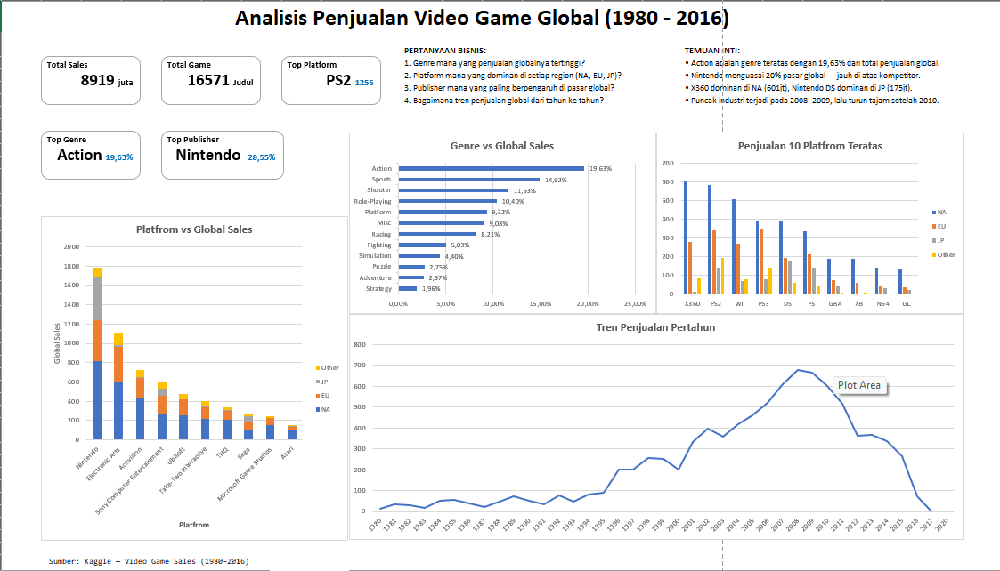

# Video Game Sales Analysis (1980–2016)

**Oleh: Adika Rais Muhammad Abror**

Analisis data penjualan video game global untuk mengidentifikasi genre dan platform terkuat, serta memahami tren industri dari tahun ke tahun menggunakan **Microsoft Excel** dan **Python**.



---

## 🎯 Ikhtisar Proyek

Proyek ini menganalisis dataset penjualan video game global yang mencakup **16.571 judul game** dari tahun **1980 hingga 2016**. Analisis dilakukan untuk menjawab empat pertanyaan bisnis utama:

1. Genre mana yang penjualan globalnya tertinggi?
2. Platform mana yang dominan di setiap region (NA, EU, JP)?
3. Publisher mana yang paling berpengaruh di pasar global?
4. Bagaimana tren penjualan global dari tahun ke tahun?

---

## 🛠️ Tools yang Digunakan

- **Microsoft Excel:** PivotTable, Chart, Slicer, Dashboard interaktif.
- **Python (Google Colab):** `pandas` (Data Cleaning & Manipulation), `matplotlib` & `seaborn` (Visualisasi Data).

---

## 💡 Temuan Utama

### 1. Genre

- **Action** adalah genre teratas dengan **19,63%** dari total penjualan global.
- Tiga genre teratas (Action, Sports, Shooter) menyumbang **46,18%** — hampir setengah pasar global.

### 2. Platform per Region

- **X360** dominan di NA (601 juta) namun hampir tidak ada di JP (12 juta).
- **Nintendo DS** adalah platform terkuat di JP (175 juta).
- **PS2** adalah satu-satunya platform yang kuat di ketiga region.

### 3. Publisher

- **Nintendo** menguasai **20%** pasar global dengan total 1.786,54 juta unit.
- Tiga publisher teratas (Nintendo, Electronic Arts, Activision) menyumbang **40,6%** dari total penjualan global.

### 4. Tren Tahunan

- Puncak industri: **2008–2009** dengan ±678 juta unit.
- Setelah 2009, penjualan turun tajam — pada 2016 di bawah 100 juta unit.

---

## 📂 Struktur Repository

```text
video-game-sales-analysis/
├── README.md
├── Ringkasan_Analisis.md            <- Laporan lengkap (metodologi & detail)
├── VideoGameSales_Dashboard.xlsx    <- File Dashboard Excel
├── Video_Game_Sales_Analysis.ipynb  <- Notebook Python (Colab)
├── dashboard.png                    <- Screenshot Dashboard
└── data/
    └── vgsales.csv                  <- Dataset asli
```

---

## 🚀 Cara Menggunakan

### Excel Dashboard

1. Unduh file `VideoGameSales_Dashboard.xlsx`.
2. Buka dengan Microsoft Excel.
3. Gunakan **Slicer** untuk memfilter data berdasarkan Genre atau Platform.

### Python Notebook

1. Buka file `Video_Game_Sales_Analysis.ipynb` menggunakan Google Colab.
2. Pastikan file dataset `vgsales.csv` berada di direktori yang sama.
3. Jalankan setiap sel dari atas ke bawah.

---

## 👤 Kontak

- **Nama:** Adika Rais Muhammad Abror
- **LinkedIn:** https://www.linkedin.com/in/adika-rais-a1742a335
- **Email:** adikarais08@gmail.com

---

*Proyek ini dibuat sebagai bagian dari portofolio Data Analyst.*
